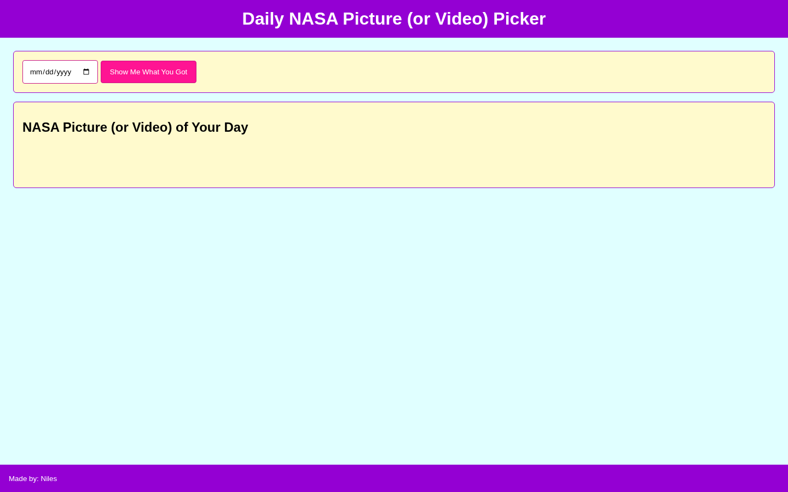

# NASA Astronomy Picture of the Day

Choose a date to view NASA's Astronomy Picture of the Day, title, and explanation.

## Overview

NASA Astronomy Picture of the Day lets a user choose a date and request the corresponding media from NASA's Astronomy Picture of the Day (APOD) API.

The application checks whether the returned media is an image or a video, then displays the media along with its title and explanation.

## Features

- Select a date
- Request NASA Astronomy Picture of the Day data
- Display image results
- Display video results
- Display the NASA-provided title
- Display the NASA-provided explanation
- Clear the previous result before a new search

## Technologies

<p>
  <a href="https://developer.mozilla.org/en-US/docs/Web/HTML" title="HTML">
    
  </a>
  &nbsp;
  <a href="https://developer.mozilla.org/en-US/docs/Web/CSS" title="CSS">
    
  </a>
  &nbsp;
  <a href="https://developer.mozilla.org/en-US/docs/Web/JavaScript" title="JavaScript">
    
  </a>
</p>

- [NASA Astronomy Picture of the Day API](https://api.nasa.gov/)

## How to Run

1. Clone the repository:

```bash
git clone https://github.com/nilesleesmith/another-simple-nasa-daily.git
```

2. Open the project folder.

3. Open `index.html` in a web browser.

No additional packages or build steps are required.

## Live Site

https://nilesleesmith.github.io/another-simple-nasa-daily/

## Screenshots

### Desktop


